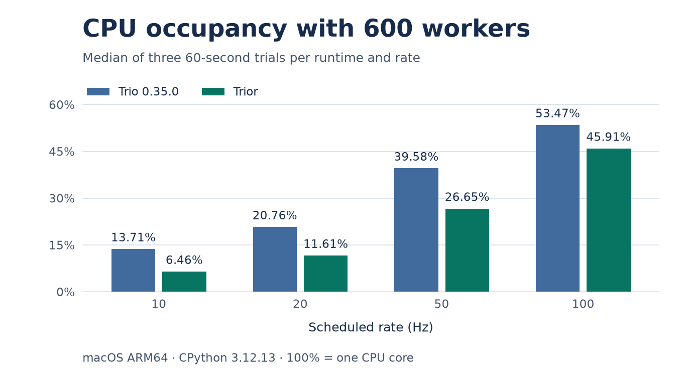

# trior

**trior** /ˈtriː.ɔːr/ — pronounced “TREE-or”.

An experimental Rust-powered async runtime for Python. Trior implements a
subset of the Trio API and explores how Rust can reduce runtime CPU overhead.

> Early development. Not a drop-in replacement for Trio or production-ready.

```python
import trior

async def worker():
    await trior.sleep(0.01)

async def main():
    async with trior.open_nursery() as nursery:
        for _ in range(600):
            nursery.start_soon(worker)

trior.run(main)
```

[Implemented APIs](docs/api.md#implemented-apis) ·
[Planned APIs](docs/api.md#planned-apis) · [Usage examples](docs/api.md#starting-and-joining-tasks)

## Performance highlights

These historical microbenchmarks compare Trior with Trio 0.35.0 on
Linux x86_64 and CPython 3.12.14.

| Workload | Trio median elapsed time | Trior median elapsed time | Speedup |
|---|---:|---:|---:|
| Start and clean up 600 children with `Nursery.start` | 15.77 ms | 3.64 ms | **4.33×** |
| Handle 3,000 readiness and receive operations on one active socket pair, with 599 parked pairs | 45.76 ms | 25.50 ms | **1.79×** (epoll) |

See the [startup benchmark](docs/research.md#stage-206-nurserystart)
and [sparse I/O benchmark](docs/HANDOFF.md#performance-evidence) for the
test conditions and CPU-time results. The [fixed-rate benchmark](#fixed-rate-benchmark)
reports CPU occupancy for a 60-second mixed workload.

## Architecture

Python executes user coroutines; Rust owns scheduler state, ready queues,
timers, cancellation and I/O readiness. Linux uses epoll; macOS uses kqueue;
poll is retained for comparison. The public Python package is `trior`.

CPython 3.12 runtime tests pass on Linux x86_64 and macOS ARM64.

- [Architecture](docs/architecture.md) and [technical handoff](docs/HANDOFF.md)
  for runtime internals and limitations.
- [Research](docs/research.md) and [roadmap](docs/ROADMAP.md) for measurements
  and future work.

## Development

CPython 3.12 is the presently supported build target; 3.15 is a development
goal. Trio 0.35.0 is used for differential tests, not required by the runtime.

```sh
uv venv --python 3.12
uv pip install --python .venv/bin/python -r requirements-dev.lock
. .venv/bin/activate
maturin develop --release --locked
python -m pytest -q
TRIOR_REACTOR=poll python -m pytest -q
```

See [CONTRIBUTING.md](CONTRIBUTING.md) for benchmark and contribution guidance.

## Acknowledgments

Trior is inspired by [Trio](https://github.com/python-trio/trio) and its
approach to structured concurrency.

We deeply appreciate the work of the Trio authors and contributors.
Trior would not exist without their ideas and contributions.

Our goal is to build on Trio's excellent design by exploring how Rust can
improve runtime performance and CPU efficiency while preserving Trio's
structured concurrency semantics.

## Fixed-rate benchmark

The benchmark compares Trio 0.35.0 and Trior with 600 concurrent workers
(timers, Events, memory channels and local socket I/O) for 60 seconds at
10, 20, 50 and 100 Hz.



To reproduce the comparison, run the benchmark from the repository root.

```sh
python benchmarks/bench_steady_state.py compare --output /tmp/trior-steady-state.json
```

The comparison runs three trials per runtime and frequency in fresh processes.
The full run takes about 24 minutes. In GitHub Actions, start **Steady-state
benchmark** manually when collecting a baseline or evaluating runtime changes.
It checks every worker's completion count and reports per-trial CPU occupancy,
process CPU time, latency percentiles and maximum, and peak RSS.
It also reports when the workload generator misses a scheduled period and
saves each trial as it completes. In the original macOS ARM64 campaign,
Trior's median CPU occupancy was 14.1% to 52.9% lower at equal completed
work. That campaign predates dispatch timing.
See [measurement protocol and results](docs/steady-state-results.md).

## License status

Trior's independent-code license has not yet been selected by the owner.
The existing Trio copyright and MIT notice are retained in
[LICENSE.Trio](LICENSE.Trio) for historical and potentially derived material.
See [licensing notes](docs/licensing.md). This is a pre-release repository;
do not interpret the upstream notice as a license grant for all Trior code.
