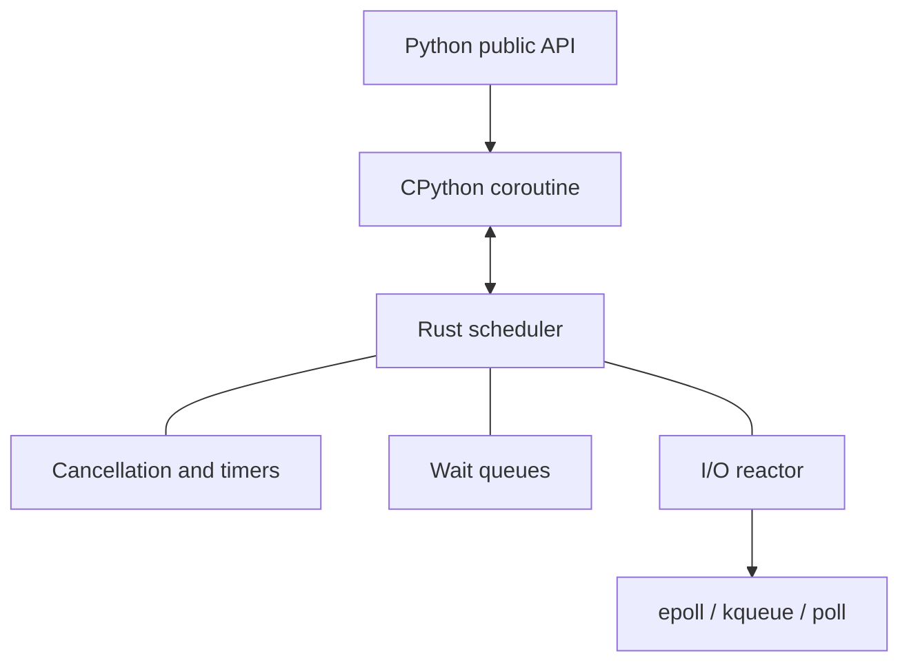

# Trior — technical handoff (Stage 20)

## Background and goal

Jun Fukuda (GitHub: jrfk) initiated Trior (トリオール) to investigate a Rust
implementation of Trio's runtime while retaining familiar Python APIs.
The objective is lower CPU consumption and faster execution for long-running
applications with roughly 600 coroutines, not merely rewriting Python in Rust.
References: Trio 0.35.0, https://github.com/python-trio/trio and
https://trio.readthedocs.io/en/stable/. Intended repository:
https://github.com/jrfk/trior. Target Python: 3.15. Proven prototype: CPython
3.12.14 on Linux x86_64; PyO3 0.30.1, Rust 1.100.0, maturin.
The project metadata currently restricts Python to >=3.12,<3.13 and pins Trio
as a dependency. These are current constraints, not final packaging goals.

The eventual migration target is `import trior as trio`, not a claim that
changing the import is already sufficient.

## Research decisions

Early stages translated the existing Trio batch loop and experimented with
native task state, attribute access, and fused scheduling. Retaining the
existing Python-owned task/runner state introduced significant boundary and
object overhead; some experiments regressed performance. Read README.md,
RESULTS_JA.md, notes/, and results/stage2 through stage17 for the actual evidence.
Keep these experiments as controls. Do not conflate improvements to upstream
Trio with the independent implementation. No upstream patch is required to
continue this project.

The independent runtime subsequently moved task records, ready queues,
timer/deadline heaps, cancellation state and parking into Rust. Python still
executes user coroutines, provides public wrappers, and stores synchronization
payloads. This is a deliberate split; replacing the Python interpreter is not
the goal, and Tokio is not required to drive Python coroutine semantics.

## Architecture



| Path | Role |
|---|---|
| src/runtime.rs | Independent native scheduler, task state, timers, scopes, parking |
| src/reactor.rs | Backend selection, fd/direction registrations, readiness tokens |
| src/reactor/epoll.rs | Linux readiness |
| src/reactor/kqueue.rs | macOS readiness |
| src/reactor/poll.rs | Comparison/fallback Unix readiness |
| src/lib.rs | PyO3 module and historical Trio adapter |
| python/trior/ | Public package, lowlevel and socket facade |
| python/trio_rust_poc/runtime.py | Python API wrappers and coroutine traps |
| spikes/runtime/ | Independent-runtime tests and benchmarks |
| tests/, benchmarks/, notes/ | Historical research, comparison controls |
| results/ | Raw results, logs, stage reports |

The native reactor releases the GIL on blocking waits, polls during continuous
ready work after bounded task steps, and removes registrations on cancellation
or close. Read/write waiters are separately tracked; generation tokens reject
old events. Readiness is level-triggered. The scheduler currently treats I/O
as parking and waking a task. epoll registration is currently added/removed for
individual waits, a likely optimization opportunity.

## Verified scope and current limitations

Stage 20 (implementation commit c783eb1; previous I/O stage 7806bbc).
Linux default epoll and poll each passed 63 tests. macOS ARM64 cross-target
cargo check passed, not actual build/link/run on a Mac. No Windows support.
CPython 3.15 and free-threaded Python remain unverified.

| Component | Status |
|---|---|
| run, sleep, sleep_until, sleep_forever, current_time, checkpoint | Basic implementation |
| open_nursery, CancelScope, deadline, dynamic shield | Basic implementation |
| Event, Lock, Semaphore, memory channels | Basic implementation |
| lowlevel.wait_readable, wait_writable, notify_closing | Implemented/tested basic cases |
| socket, socketpair, from_stdlib_socket | Implemented partial facade |
| recv, recv_into, send, accept | Implemented partial facade |
| epoll/poll | Linux tested |
| kqueue | macOS cross-target check only |
| TCP connect, SocketStream, SocketListener, open_tcp_stream | Not implemented |
| DNS, thread bridges, guest mode, instrumentation | Not implemented |
| AnyIO, full upstream suite, production cleanup | Not verified |

Full API parity, full cancellation/exception semantics, FD duplication and
external close without notification, thread wakeups, signals, abnormal exit
cleanup and resource leakage remain open. Treat current implementation as
experimental. Consult code and add differential tests instead of assuming parity.

## Performance evidence

Stage 18, CPU ratios for 12,000 operations of sync primitives (not wall-time
speedups): Event 3.29x, Lock 2.77x, Semaphore 2.31x, memory channel(0) 2.87x,
memory channel(64) 2.46x. Earlier 600-task comparisons summarized in the
Stage 18 report: checkpoint 3.25x, timer 11.14x, mixed 4.71x, idle cancellation
4.09x, deadlines 1.46x. See results/stage18/RESULTS_JA.md and the previous
stage reports for metric definitions and raw samples.

Stage 19 (poll) 600 dense socket pairs: Trio wall 126.66ms / CPU 126.63ms,
Trior wall 95.57ms / CPU 68.59ms (45.8% CPU reduction).

Stage 20: sparse I/O, one active socket pair among many parked pairs, 3,000
readiness/receive operations, 10ms initial wait, setup/cleanup included,
five repeats per condition, medians. All times in ms:

| Pairs | Trio wall | Trior poll wall | Trior epoll wall | Trio CPU | poll CPU | epoll CPU |
|---:|---:|---:|---:|---:|---:|---:|
| 64 | 32.31 | 23.67 | 22.83 | 22.21 | 13.76 | 12.75 |
| 600 | 45.76 | 98.45 | 25.50 | 37.66 | 88.11 | 16.18 |
| 2000 | 79.44 | 318.98 | 44.24 | 78.88 | 307.80 | 38.50 |

At 600 pairs, epoll Trior was 1.79x faster and used 57.0% less CPU than Trio;
81.6% less CPU than the Trior poll comparison.

Dense I/O, 600 pairs, 30 rounds, 2ms sleep per round:

| Backend | Wall ms | CPU ms | CPU occupancy |
|---|---:|---:|---:|
| Trio | 115.73 | 115.54 | 99.8% |
| Trior poll | 85.75 | 53.48 | 62.4% |
| Trior epoll | 98.91 | 73.32 | 74.1% |

epoll wins against Trio but loses to Trior poll in dense traffic. Repeated
epoll_ctl ADD/DEL is a hypothesis, not proven. Profile before optimizing.
CPU occupancy is process CPU time / elapsed time, with one core = 100%.
These short synthetic benchmarks do not predict production CPU use.

Evidence: [Stage 18](../results/stage18/RESULTS_JA.md),
[Stage 19](../results/stage19/RESULTS_JA.md),
[Stage 20](../results/stage20/RESULTS_JA.md). Re-run against the same interpreter
and hardware; compare both CPU time and wall time.

## Reproduction

Follow AGENTS.md build instructions. Useful commands after activation:

```sh
python spikes/runtime/bench_runtime.py
python spikes/runtime/bench_sync.py
python spikes/runtime/bench_sparse_io.py trio --count 600
python spikes/runtime/bench_sparse_io.py trior --count 600
TRIOR_REACTOR=poll python spikes/runtime/bench_sparse_io.py trior --count 600
python spikes/runtime/bench_io.py trio --count 600
python spikes/runtime/bench_io.py trior --count 600
TRIOR_REACTOR=poll python spikes/runtime/bench_io.py trior --count 600
```

For ARM64 macOS cross-target checking from Linux (does not replace CI on Mac):

```sh
rustup target add aarch64-apple-darwin
PYO3_CROSS=1 PYO3_CROSS_PYTHON_VERSION=3.12 cargo check --locked --target aarch64-apple-darwin
```

## Where to resume

Stage 21 is the next task, not already implemented. See ROADMAP.md for
acceptance criteria. Keep the new code in the independent Trior runtime;
do not replace it with a Trio wrapper or benchmark a different workload under
the same label. Use GitHub commits and PRs for subsequent work at owner's
direction. GitHub creation was reported by the owner; this archive does not
assert a successful remote push.
