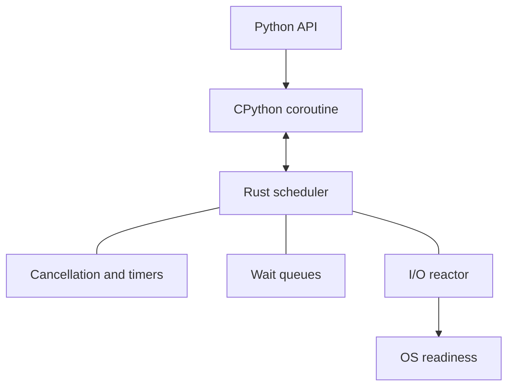

# Architecture

- `python/trior/`: public facade, coroutine traps and runtime wrappers.
- `src/runtime.rs`: tasks, ready queue, deadline heaps, cancellation, parking.
- `src/reactor.rs`: registrations, token ownership, backend selection.
- `src/reactor/`: Linux epoll, macOS kqueue, Unix poll implementation.
- `src/lib.rs`: PyO3 extension registration.
- `tests/`: differential and native runtime regression tests.
- `benchmarks/`: equivalent-work performance comparisons with Trio 0.35.0.

The scheduler runs CPython coroutine steps and restores contextvars.
The reactor releases the GIL while blocking, handles separate read/write
waiters and invalidates stale readiness via registration tokens. Synchronization
payloads remain Python-owned. Full compatibility is not yet established.
See HANDOFF.md for current limitations and ROADMAP.md for next steps.
